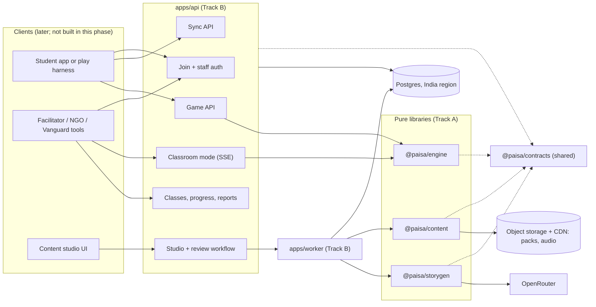

> **Superseded (2026-10-10).** The team follows `CLAUDE.md` on `main`: a pnpm workspace with Supabase, `packages/shared` contracts and the BE-1 / BE-2 lanes. The Fastify/Drizzle `backend/` this doc describes was removed. Kept for reference only.

# Paisa Path — Backend Design & Parallel Plan

Oct 10, 2026 · Parth Sharma · Draft v0.1

This doc is for the two developers building the Paisa Path backend. It explains what we are building, how the code is laid out, and how we split the work so both of us can push to `main` every day without breaking each other. If you are new, read it top to bottom once. After that, use **Work split**, **Phase plan** and **Rules that keep main green** as your day-to-day reference.

The product itself is described in [Paisa Path — Product & Component Design.md](Paisa%20Path%20—%20Product%20%26%20Component%20Design.md), and repo-wide rules are in [CLAUDE.md](../CLAUDE.md). This doc covers only the backend and does not repeat the product design.

## Summary

- **Scope:** the backend does everything end to end. That covers the game engine, content and content packs, AI story generation, the student game and sync APIs, staff APIs (classes, progress, classroom mode, reports), auth, the database and deployment. There is no frontend in this phase.
- **Shape:** a TypeScript monorepo in `backend/`. Pure libraries (`engine`, `content`, `storygen`) are kept separate from the I/O layer (`db`, `api`), and a shared `contracts` package of zod schemas sits between them.
- **Split:** **Track A, Game & Content**, owns the pure libraries and the content. **Track B, Platform & Data**, owns the database, the API and the infrastructure. They meet only at `@paisa/contracts` and at the public `index.ts` of each package.
- **Safety net:** stub-first seams, a boundary checker, frozen contracts with a changelog, and CI on every PR.
- **Story generation** runs at authoring time through OpenRouter. Every draft goes through the review workflow before it can reach a student.

## What the backend does

| Area | What it means | Track |
| --- | --- | --- |
| Game engine | The 12-month weekly simulation and all eleven engine components from the product design, plus assessment and reward rules | A |
| Content | Scenario, event, lesson and quiz data; validation; guardrail lint; versioned content packs per language and region | A |
| Story generation | Generates draft scenarios and story text from an author's brief, drafts translations, and checks every draft before review | A |
| Game API | Runs the engine on the server so the whole game can be played over HTTP (start a game, choose, rewind, see the month-end) | B |
| Sync API | Accepts queued events from offline clients without duplicates, so a future offline app works unchanged | B |
| Identity | Students join with a class code and get an anonymous ID; staff sign in with an email one-time code | B |
| Staff APIs | Organisations, centres, classes, class codes, progress heatmap, inactive flags, classroom mode, lesson plans, learning gains, reports, certificates | B |
| Content studio API | Writing content, generating drafts, the review workflow and publishing packs | B (calls A's libraries) |
| Data and infra | Postgres schema and migrations, row-level security, retention job, object storage and CDN, deploys in an India region | B |

**Out of scope for now:** the student PWA, the NGO dashboard UI and the studio UI. We expose clean APIs (OpenAPI generated from contracts) so any of these can be built later. To test the game without a frontend we use a terminal play harness (A26) and API end-to-end tests.

## Key decisions

| # | Decision | Choice | Why |
| --- | --- | --- | --- |
| D1 | Repo shape | npm-workspaces monorepo in `backend/` | Built into Node and needs no extra installs on Windows. Clear package boundaries. |
| D2 | Language and runtime | TypeScript on Node 22 LTS, ESM, run with `tsx` | One language from the engine to the API. The engine stays portable to a future PWA. |
| D3 | HTTP | Fastify 5, stateless | Fast, has schema-first routing and testing through `app.inject`. Stateless matches the design's scale path. |
| D4 | Database | Postgres 17 + Drizzle ORM + `postgres` driver, with row-level security as a second line of defence | SQL suits reporting. RLS keeps facilitators to their own classes even if a route has a bug. |
| D5 | Schemas | zod 4 in `@paisa/contracts`, the single source of truth; JSON Schema and OpenAPI generated from it | Types, runtime validation, LLM output schemas and API docs all come from one definition. |
| D6 | Engine placement | Pure package, run by the API for server-side play and replay | Fits "everything in the backend". Because the engine is pure, a future offline client can bundle the same code. |
| D7 | Story generation | Authoring time only, through OpenRouter, behind an `LlmClient` port | Every scenario needs compliance review, fixed text for translation and voice-over, and deterministic play. Live generation on a student request would break all three. |
| D8 | Content source of truth | Postgres (`content_items`, `strings`), with JSON fixtures and seed files in `backend/content/` | Authors and reviewers work through the studio API without git. Fixtures keep tests reproducible. |
| D9 | Content delivery | Pack builder output → object storage → CDN; the API serves a manifest | Content ships separately from code releases. |
| D10 | Student auth | Class code → server-issued `anon_id` + device token (JWT) | No personal identifiers. Several profiles can share one phone. |
| D11 | Staff auth | Email one-time code → short-lived JWT with role claims (facilitator, ngo_admin, vanguard) | Matches the product design. No passwords to leak. |
| D12 | Sync | Batches of up to 500 events; `eventId` is a client UUID; insert with `ON CONFLICT DO NOTHING`; the response lists the accepted IDs | Safe to retry on flaky connections. |
| D13 | Classroom mode realtime | Server-Sent Events to the projector, plain POST for votes; Postgres `LISTEN/NOTIFY` once we run more than one instance | Simpler than WebSockets and works through school proxies. |
| D14 | Background jobs | A Postgres-backed queue (e.g. pg-boss) in an `apps/worker` process, added in Phase 2 | No extra infrastructure. Story generation, pack builds, reports and retention run there. |
| D15 | Hosting | India region (e.g. AWS ap-south-2 Hyderabad or ap-south-1 Mumbai), managed Postgres, S3-compatible storage + CDN | Data residency. |
| D16 | Naming | JSON and TypeScript use camelCase, the database uses snake_case, content IDs are dotted lowercase (`budget.recharge.01`), and translation keys start with `t:` | Applied consistently, so nobody has to debate it later. |

## Architecture



### Three flows to keep in mind

1. **Play a week.** `POST /v1/games/:id/actions {choose: "b"}` → the API loads the save → `engine.step(state, action, pack)` returns the new state, the next view and the events → the API saves the state and logs the events in one transaction → it returns the view (consequence, jar changes, lesson card).
2. **Create content.** An author posts a brief → a worker job calls `storygen.generateScenarioDraft` → the draft is stored with its lint results and provenance → reviewers move it through the workflow → on publish, a worker calls `content.validateSource` and `content.buildPacks` → the packs go to storage and a `content_packs` row is written → clients pick up the new manifest.
3. **Facilitator checks a class.** `GET /v1/classes/:id/progress` → aggregate queries over `decision_events` and `quiz_attempts` under RLS → a heatmap of modules per nickname plus inactive flags.

## Repository layout and ownership

```
backend/
  package.json            workspace root and scripts            shared (B merges)
  tsconfig.base.json      compiler settings                     shared
  docker-compose.yml      local Postgres                        B
  .env.example            every env var, documented             shared
  scripts/
    check-boundaries.mjs  import and purity rules (CI)          shared
  content/                fixtures, seed data, region bibles    A
    fixtures/             small pack used by ALL tests          A
  packages/
    contracts/            zod schemas + types (the seam)        shared, both approve
    engine/               pure simulation                       A
    content/              validate, lint, build packs           A
    storygen/             LLM port, OpenRouter adapter, prompts A
    db/                   Drizzle schema, migrations, RLS       B
  apps/
    api/                  Fastify app, routes, auth             B
    worker/               jobs (Phase 2)                        B
.github/workflows/backend.yml   CI                              B
.claude/agents/paisa-backend.md Claude Code agent with this context  shared
```

### Allowed imports

The rules below are enforced by `npm run check:boundaries`. Each package may import only the packages listed for it, and only through their root entry (`@paisa/x`, never `@paisa/x/src/...`).

| Package | May import |
| --- | --- |
| `contracts` | nothing internal |
| `engine` | contracts |
| `content` | contracts |
| `storygen` | contracts, content |
| `db` | contracts |
| `api` (and later `worker`) | everything |

`contracts` and `engine` must also stay **pure**: no `Math.random`, `Date.now`, `new Date()`, `fetch`, `process` or Node built-ins. Time and randomness are passed in as arguments.

## Components

### Engine (`packages/engine`, Track A)

Each design component gets its own module, and only `src/index.ts` exports from them.

| Module | Component | Notes |
| --- | --- | --- |
| `rng.ts` | Seeded random generator | Done in the scaffold (mulberry32). Its state is a uint32 stored in `GameState`. |
| `clock.ts` | Simulation clock | 12 months × 4 weeks. Emits payday, decision, event and month-end phases. |
| `income.ts` | Income model | Steady, seasonal or irregular, with the parameters taken from persona tuning in the pack |
| `wallet.ts` | Wallet and jars | Transfers between jars. Overspending is blocked unless the player borrows, and debt is tracked. |
| `selector.ts` | Scenario selector | Filters by module, persona, level and unseen cards, and serves more of what the player got wrong |
| `events.ts` | Event deck | Weighted by persona and level. Draws use the seeded RNG. |
| `effects.ts` | Effects resolver | Applies jar deltas now and queues `delayed` effects with a due week |
| `goal.ts` | Goal tracker | Progress and milestones (25/50/75/100%) |
| `score.ts` | Money Health Score | 0–100 from savings rate, emergency fund, goal progress and debt. The weights come from the pack. |
| `rewind.ts` | Rewind manager | Snapshot before each decision, 3 tokens a month. A rewind restores the full state, including the RNG. |
| `lesson.ts` | Lesson engine | The lesson card for each outcome and the month-end reflection question |
| `assessment.ts` | Quizzes | Assembles quizzes by tag (parallel baseline and end-line forms) and scores them |
| `rewards.ts` | XP, badges, streaks | Streaks include one free "pause" a month. Stars stay separate from rupees. |
| `projection.ts` | Time Machine maths | Always returns good, average and bad ranges with their assumptions, never a single number |
| `step.ts` | Public entry | `newGame` and `step`, which tie all of the above together |

The engine's "save and event logger" is split in two. The engine returns events from `step`, and the API persists them. That split keeps the engine pure.

### Content (`packages/content` + `backend/content`, Track A)

- **Schemas** live in contracts: `Scenario` today, with `EventCard`, `LessonCard`, `QuizQuestion`, `Persona`, `Tuning`, `ScamMessage` and `PackManifest` added in v0.2.
- **`validateSource`** checks the schemas, cross-references (every `t:` key exists, every choice references real jars, the personas exist), string coverage per language, and tuning ranges.
- **`lintGuardrails`** checks for:
  - real financial brand names, using a deny-list of banks, funds, brokers, payment apps, loan apps and betting apps;
  - single-number return promises and "guaranteed" language;
  - shaming words about poverty or family;
  - outbound links other than 1930 and cybercrime.gov.in;
  - Stars mixed into rupee effects.
- **`buildPacks`** produces one pack per region and language, with sha256 hashes and a manifest. It is pure, and the caller stores the result.
- **`backend/content/`** holds the fixtures (the small pack every test uses), seed content, the persona bibles, and the region bible for Hyderabad (festivals, places, typical prices). Storygen uses the bibles too.

### Story generation (`packages/storygen`, Track A)

See the next section.

### Database (`packages/db`, Track B)

See **Data model**. Track B owns the schema, the migrations, RLS policies and seed scripts.

### API (`apps/api`, Track B)

The API has one Fastify plugin per area (`routes/game.ts`, `routes/sync.ts`, ...). Every request and response body is a contracts schema, and OpenAPI is generated from those schemas. Auth hooks attach `{ role, orgId, classIds }` or `{ profileId, classId }` to each request.

## Story generation pipeline

**Goal:** an author or content lead types a short brief, and the backend writes the scenario. That means the story text, 2–4 choices with effects, lesson cards and any delayed consequence, all in the exact scenario JSON format, ready for review.

```
brief ──▶ prompt assembly ──▶ OpenRouter (JSON schema) ──▶ zod parse ──▶ validate + guardrail lint ──▶ draft row
            ▲                                                  │ fail: retry once with the errors
   persona bible, region bible,                                 ▼
   tuning ranges, style guide,                          status = draft (or needs_fix)
   2–3 approved examples
```

1. **Brief** (`ScenarioBrief`): pillar, concept, personas, difficulty, region and optional notes ("set it during Bonalu").
2. **Prompt assembly.** The system prompt holds the guardrails (fictional assets only, no real brands, no shaming, ranges instead of promises) and the house style (short sentences, Class 9 reading level, a local setting). The user prompt holds the brief, the matching persona bible, the region bible, the allowed effect ranges from tuning, and 2–3 approved scenarios as examples. Prompts are versioned files in `storygen/src/prompts/`, and the version is recorded on every draft.
3. **Model call** through `LlmClient`. The OpenRouter adapter sends `response_format: json_schema` with a schema generated from the zod `Scenario` plus a strings map. The model is chosen with `OPENROUTER_MODEL`, so we can switch models without code changes.
4. **Parse and check.** zod parses the output, then `validateSource` and `lintGuardrails` run on it. If there are errors, the generator retries once with the errors added to the prompt, and after that it saves the draft as `needs_fix`.
5. **Store** (Track B). The draft is stored with its lint results and provenance: model, prompt version, brief, token usage and cost.
6. **Translations.** After English is approved, `translateStrings` drafts Telugu, Urdu and Hindi against each language's glossary. It flags glossary misses, and UPI, OTP and EMI stay in English. Machine translations are always marked as drafts, and a native-speaker check is mandatory.
7. **Review workflow** (Track B enforces the state machine; Track A defines what counts as "valid"):
   `draft → financial_review → compliance_review → translation → native_check → pilot → published`
   Each transition records the reviewer and the time. Publishing requires `compliance_review` approval, which is the brief's evidence that the guardrail is followed.
8. **Cost and safety controls.** Generation runs only in worker jobs and never on a student request. Staff accounts have per-user daily limits, every call is logged with its token usage, and the API key is read only from env.

**Testing storygen without spending money:** use a `FakeLlmClient` that returns recorded responses from `storygen/test/recordings/`. The live OpenRouter call happens only in a manual `npm run storygen:try` script.

## Data model

Track B owns these tables. The field lists are the minimum we need. Track B adds indexes, timestamps and foreign keys.

| Table | Key fields | Notes |
| --- | --- | --- |
| `organisations` | id, name, city | A partner NGO |
| `centres` | id, org_id, name, type | A school or community centre |
| `classes` | id, centre_id, class_code (unique), default_language, facilitator_id, programme_ends_at, flags | The class code is how students join. `flags` holds per-class feature flags. |
| `staff_users` | id, org_id, name, email, role | Adults only |
| `otp_codes` | email_hash, code_hash, expires_at, attempts | Rate-limited, and only hashes are stored |
| `student_profiles` | anon_id, class_id (nullable after retention), nickname, avatar, grade_band, language, maturity_level | No personal identifiers |
| `game_saves` | id, profile_id, persona_id, pack_version, state (jsonb), month, week, score, seed, updated_at | One row per persona played. `state` is an engine `GameState`. |
| `events` | event_id (pk, client UUID), profile_id, type, occurred_at, seq, payload (jsonb), received_at | All synced and server-generated events. Insert with `ON CONFLICT DO NOTHING`. |
| `decision_events` | event_id, profile_id, scenario_id, choice_id, rewound, occurred_at | A projection of `events` for analytics |
| `quiz_attempts` | id, profile_id, quiz_id, kind (baseline/module/endline/retention), answers, score | Feeds learning gains |
| `rewards` | profile_id, badge_id or xp, earned_at | |
| `content_items` | id, kind, body (jsonb), tags, status, version, provenance (jsonb) | Scenarios, events, lessons, quizzes and the rest |
| `strings` | key, language, text, status | Translation strings |
| `content_reviews` | item_id, from_status, to_status, reviewer_id, note, at | Review history and audit trail |
| `content_packs` | id, region, language, version, sha256, url, published_at | What phones and the Game API load |
| `classroom_sessions` | id, class_id, scenario_id, state, opened_at, closed_at | |
| `classroom_votes` | session_id, profile_id or group_label, choice_id | One vote per profile or shared-phone group |
| `jobs` | managed by the queue library | |

**RLS:** facilitators can read only rows whose `class_id` is one of their classes. NGO admins can read rows in their organisation. Vanguard reads aggregate views only, and every cell in those views must cover at least 10 students. Students can touch only their own `anon_id`.

**Retention:** a job runs at each class's `programme_ends_at`. It sets `student_profiles.class_id` to null and keeps only the aggregate tables.

## API surface (v1)

All routes are under `/v1` except `/health`. **Track B** builds every route. The second column shows which Track A library each route calls.

| Route | Uses | Who |
| --- | --- | --- |
| `GET /health` | – | anyone |
| `POST /v1/join` `{classCode, nickname, avatar}` → `{anonId, token}` | nickname word filter | student |
| `GET /v1/me/profiles` | – | student device |
| `POST /v1/games` `{persona, level}` → `{gameId, view}` | engine | student |
| `GET /v1/games/:id` | engine | student |
| `POST /v1/games/:id/actions` `{choose \| rewind \| advance}` → `{view, events}` | engine | student |
| `POST /v1/sync` `SyncBatch` → `{accepted: eventId[]}` | contracts | student |
| `GET /v1/content/manifest?region&lang` and `GET /v1/content/packs/:id` | – | student |
| `POST /v1/quizzes/:kind/start` and `POST /v1/quizzes/:attemptId/submit` | engine (assessment) | student |
| `POST /v1/auth/otp/request` and `POST /v1/auth/otp/verify` | – | staff |
| `CRUD /v1/orgs`, `/v1/centres`, `/v1/classes` (+ `GET /v1/classes/:id/join-sheet.pdf`) | – | staff |
| `GET /v1/classes/:id/progress` (heatmap + inactive flags) | – | facilitator |
| `POST /v1/classroom/sessions`, `GET .../stream` (SSE), `POST .../votes`, `POST .../reveal` | engine (effects for the reveal) | facilitator, student |
| `GET /v1/lesson-plans/:module` | content | facilitator |
| `GET /v1/reports/learning-gains`, `GET /v1/reports/export.csv`, `.pdf` | – | NGO admin, Vanguard |
| `GET /v1/certificates/:anonId.pdf` | – | student, facilitator |
| `CRUD /v1/studio/items`, `/v1/studio/strings` | content (validate) | content staff |
| `POST /v1/studio/drafts/generate` `ScenarioBrief` → `{jobId}` | storygen | content staff |
| `POST /v1/studio/items/:id/transition` `{to, note}` | content (validate) | reviewers |
| `POST /v1/studio/publish` `{region, version}` → `{jobId}` | content (build) | content lead |

## Work split

### The two tracks

| | **Track A — Game & Content** | **Track B — Platform & Data** |
| --- | --- | --- |
| One-line rule | Pure logic and content. Takes its I/O as injected arguments. | Everything that touches the network, disk, database or clock. |
| Owns | `packages/engine`, `packages/content`, `packages/storygen`, `backend/content/` | `packages/db`, `apps/api`, `apps/worker`, `docker-compose.yml`, CI, deploys |
| Co-owns | `packages/contracts` (content and game schemas, as lead) | `packages/contracts` (events and API DTOs, as lead) |
| Delivers to the other track | Engine `newGame`/`step`, `validateSource`, `lintGuardrails`, `buildPacks`, `generateScenarioDraft`, `translateStrings`, fixtures | Running API, DB, job queue, storage, the studio workflow that calls A's libraries, an end-to-end test harness |
| Never does | Writes migrations or routes; reads env vars; imports `db` or `api` | Reimplements game or content rules; hand-writes content JSON in tests (uses fixtures) |

Who takes which track is agreed between us. Put the names here: **Track A:** ______ · **Track B:** ______

### The seams

These are the only places the two tracks touch. Each seam exists as a typed stub from day one, so the consumer can build against it before the provider has finished.

| Seam | Provider → consumer | Signature (in code) | Status |
| --- | --- | --- | --- |
| S1 Contracts | both | `@paisa/contracts`: `Scenario`, `ContentSource`, `SyncEvent`, `SyncBatch`, … | v0.1 in the scaffold |
| S2 Engine | A → B | `newGame(input, pack): GameState` · `step(state, action, pack): { state, view, events }` | stub in P0.3 |
| S3 Content pipeline | A → B | `validateSource(source)` · `lintGuardrails(item)` · `buildPacks(source, opts)` | stubbed in the scaffold |
| S4 Story generation | A → B | `generateScenarioDraft(brief, {llm})` · `translateStrings(strings, lang, glossary, {llm})` · `createOpenRouterClient(cfg)` | stubbed; the adapter is implemented |
| S5 Fixtures | A → B | `backend/content/fixtures/**`, the only content tests may use | 1 scenario + strings in the scaffold |
| S6 HTTP API | B → future clients | OpenAPI from contracts at `/v1/openapi.json` | B7 |

A stub throws `not implemented yet (task Axx)` or returns fixture data. When the provider replaces a stub, the signature must not change. If it has to change, that is a contract change (see below).

### Rules that keep main green

1. **Stay in your folders.** A change outside your track's folders needs a PR approved by the other owner, even for one line.
2. **Public API only.** Import `@paisa/x`, never deep paths. Each package exports only from `src/index.ts`. `check:boundaries` fails the build otherwise.
3. **Dependency direction is fixed** (see the Allowed imports table). To change it, edit `ALLOWED` in `scripts/check-boundaries.mjs` in a PR approved by both owners.
4. **Engine and contracts are pure.** No randomness, clock, network, env or Node built-ins. CI enforces this.
5. **Contracts are additive by default.** Add optional fields and new types freely in a PR the other owner approves. Breaking changes follow the protocol below.
6. **Stub before you start.** Before a consumer starts work against a seam, the provider merges the typed stub.
7. **Fixtures are the shared truth.** Track B tests use `backend/content/fixtures` only. When Track A changes the content shape, Track A updates the fixtures in the same PR.
8. **Migrations are Track B only and forward-only.** Generate them with `npm run db:generate` and never edit a merged migration. If Track A needs a new column, open an issue labelled `seam`.
9. **Main is always green.** CI runs `npm run check` (boundaries, typecheck and tests across all packages) on every PR. Nothing red gets merged, and nobody pushes directly to `main`.
10. **Small PRs, rebased daily.** Branch names use the track prefix: `a/engine-clock` or `b/sync-endpoint`. Aim for a review within one working day.
11. **Every env var goes in `.env.example`**, in the same PR that starts reading it. Secrets never go in git.
12. **No real financial products, anywhere.** That covers fixtures, prompts, tests and seed data. The guardrail linter runs over `backend/content` in CI once A17 lands.

### Contract-change protocol

1. Open a PR that touches only `packages/contracts`, labelled `contracts`, with a `CHANGELOG.md` entry.
2. **Additive** changes (new optional field, new schema or enum value nobody switches on exhaustively) need one approval from the other owner. Bump the patch or minor version.
3. **Breaking** changes (rename, remove, required field, changed meaning) need the following:
   - mark the entry **BREAKING** and bump the minor version (we stay below 1.0 during the MVP);
   - fix every consumer in the same PR, or land the new shape next to the old one first and remove the old one in a follow-up;
   - get approval from both owners.
4. `CONTRACTS_VERSION` in `src/index.ts` must match `package.json`. `/health` reports it, so mismatched deploys are easy to spot.

### How we work together

- **Twice a week, 15 minutes:** what merged, what is blocked on a seam, and what is next.
- **GitHub issues labelled `seam`** for anything one track needs from the other. Each issue names the task ID and the signature needed.
- **Integration checkpoints** (below) are the only times we need to land work together. Between them, each track merges on its own.

## Phase plan

The plan is timed against the product design's ~15-week MVP. Task IDs are used in branch names, issues and stub messages. "→" marks a dependency on the other track.

### Phase 0 — Foundation (week 1, both)

| ID | Task | Owner |
| --- | --- | --- |
| P0.1 | Scaffold: workspace, packages, CI, boundary checker | done in this commit |
| P0.2 | Contracts v0.1 → v0.2: `GameState`, `Action`, `View`, `ContentPack`, `Persona`, `Tuning`, `EventCard`, `LessonCard`, `QuizQuestion`, payloads per event type | A leads game/content, B leads events/API; both approve |
| P0.3 | Stub every seam function with its final signature (S2 engine stub returns a fixture view) | A |
| P0.4 | Fixture pack: 1 persona with tuning, 4 scenarios across 2 pillars, 2 events, 1 quiz of 5 questions, English strings | A |
| P0.5 | Local DB up, first empty migration, test DB helper (`createTestDb()` per test file) | B |

### Phase 1 — Core loop (weeks 2–5)

| Track A | Track B |
| --- | --- |
| A1 RNG + seed derivation (`hashSeed(anonId, persona)`) | B1 Schema + migrations for the Data model tables |
| A2 Simulation clock | B2 RLS policies + tests that prove facilitator isolation |
| A3 Income model (steady / seasonal / irregular) | B3 Staff email OTP auth (email port; logs to the console in dev) |
| A4 Wallet and jars, borrowing, debt | B4 Student join: class code → anon_id + token, nickname word filter, several profiles per device |
| A5 Effects resolver with delayed effects | B5 Sync endpoint: idempotent, ordered by `seq`, max 500 per batch |
| A6 Rewind manager (3 tokens a month, full restore) | B6 Game API: `POST /games`, `GET /games/:id`, `POST /games/:id/actions` on the S2 stub, then the real engine |
| A7 `validateSource` | B7 OpenAPI generation from contracts |
| A8 `newGame` / `step` wiring + golden determinism test (same seed → identical 12-month transcript) | B8 Content manifest and pack download from local storage (fixture pack) |

**Checkpoint 1 (end of week 5):** an API end-to-end test starts a game for the fixture persona, plays 4 weeks with one rewind, and asserts that the save and the events in the DB match an engine-only run with the same seed.

### Phase 2 — Full game, staff tools, content pipeline (weeks 6–9)

| Track A | Track B |
| --- | --- |
| A9 Scenario selector (serves more of what the player got wrong) | B9 Orgs, centres, classes CRUD; class code + QR; printable join sheet |
| A10 Event deck (weighted, seeded) | B10 Progress heatmap + 7-day inactive flags |
| A11 Goal tracker + milestones | B11 Quiz endpoints + learning-gain aggregation (baseline vs end-line) |
| A12 Money Health Score | B12 `apps/worker` + job queue |
| A13 Lesson engine + reflection questions | B13 Studio API: items, strings, review state machine with role checks, audit trail |
| A14 Assessment: quiz assembly by tags, parallel forms, scoring | B14 → A18: `POST /studio/drafts/generate` as a job, with per-user limits and cost logging |
| A15 Rewards: XP, badges, streak with monthly pause | B15 → A16: publish pipeline that builds packs → storage → `content_packs` rows |
| A16 `buildPacks` + manifest + hashes | B16 Classroom mode: sessions, SSE stream, votes, reveal |
| A17 `lintGuardrails` v1 + deny-lists; runs in CI over `backend/content` | |
| A18 `generateScenarioDraft` v1: prompts, JSON schema output, retry on errors, recorded-response tests | |

**Checkpoint 2 (end of week 9):** generate a draft from a brief, move it through review to published, build the pack, start a game that uses it, and run a classroom session that votes on it.

### Phase 3 — Real content and hardening (weeks 10–13)

| Track A | Track B |
| --- | --- |
| A19 Hyderabad pack: generate and curate scenarios for 4 pillars × Levels 1–2 × 4 personas, working with the content writer | B17 Reports: CSV and PDF exports; Vanguard aggregates with a minimum of 10 students per cell |
| A20 `translateStrings` + glossaries for te/ur/hi; native-speaker check stays mandatory | B18 Certificate PDF (blank line for a real name, which is never stored) |
| A21 Balancing simulator: 10k seeded games per persona; report on score spread, broke rate and goal-reach rate; tune the numbers | B19 Retention job: unlink profiles at programme end |
| A22 Projections for the Time Machine and Basket Builder (good/average/bad ranges and assumptions, all as data) | B20 Deploys: test and live environments in an India region, CDN, secrets, backups, per-class feature flags |
| A23 Scam-or-Safe and Message Inspector content model (messages with tappable suspicious spans) | B21 Security: rate limits, OTP brute-force protection, RLS test suite, dependency audit |
| A24 Lesson plans and worksheets as content (served by B's route) | B22 Load test at 1,500 and 150,000 simulated students; self-hosted metrics only |

**Checkpoint 3 (end of week 13):** the Hyderabad pack is live in four languages on the test environment, and the full golden path, plus reports, runs against it.

### Phase 4 — Pilot readiness (weeks 14–15, both)

Bug bash. Support the usability and compliance pass with about 30 students. Freeze contracts at v1.0. Write the runbook. Launch the pilot.

**A25** (Phase 1, whenever free): `npm run play`, a terminal harness that plays the engine directly against the fixture pack. **A26** (after B6): the same harness pointed at the API. These let us play the whole game with no frontend.

### Definition of done (every task)

- The code is in the owner's folders, and any seam signature is unchanged or changed through the contract protocol.
- Tests are in the same PR. Engine logic has seeded tests, and routes have `app.inject` tests against a real test database.
- `npm run check` passes locally and in CI.
- New env vars are in `.env.example`, and a new command is in `backend/README.md` and `CLAUDE.md`.

## Testing strategy

| Level | Where | What |
| --- | --- | --- |
| Unit | `packages/*/test` | Engine maths, determinism, selectors, lint rules, prompt assembly with a fake LLM |
| Golden | `packages/engine/test/golden` | Fixed seed → recorded 12-month transcript. Any change in output must be deliberate, with the snapshot updated in the PR. |
| Contract | `packages/contracts/test` | Fixtures parse. Examples of every schema round-trip through JSON Schema. |
| Route | `apps/api/test` | `app.inject` against a real Postgres (docker locally, a service container in CI) |
| End-to-end | `apps/api/test/e2e` | The checkpoint scenarios above |
| Load | `backend/load` (B22) | Sync and Game API under pilot and 100× load |

## Guardrails and privacy in the backend

| Rule | Where the backend enforces it |
| --- | --- |
| Educate, never recommend | `lintGuardrails` deny-list; storygen system prompt; compliance approval required to publish |
| Projections are ranges | `projection.ts` returns only `{good, average, bad, assumptions}`; contracts have no single-value projection type |
| No real money | No payment or bank integrations exist; the lint blocks payment links |
| Safe outbound links only | The lint allow-list holds only 1930 and cybercrime.gov.in |
| No personal data | No name, phone or birth-date columns on students; staff email is the only personal identifier and stays adults-only |
| Nickname filter | Word filter on join and on rename (B4), with a list per language |
| Access control | Route auth hooks + Postgres RLS + aggregate-only Vanguard views |
| Data residency | India region for the DB, storage and backups; OpenRouter receives only content briefs, never student data |
| Retention | Unlink job at programme end (B19) |
| No trackers | No third-party analytics SDKs; events live in our own DB |

## Local setup

```bash
cd backend
cp .env.example .env          # add your OPENROUTER_API_KEY and OPENROUTER_MODEL if you work on storygen
npm install
npm run db:up                 # Postgres in Docker
npm run check                 # boundaries + typecheck + tests
npm run dev                   # API on http://localhost:3000/health
```

| Command | What it does |
| --- | --- |
| `npm run check` | Everything CI runs. Run it before every push. |
| `npm test` / `npx vitest run packages/engine` | All tests, or the tests for one package |
| `npm run typecheck` | `tsc` in every workspace |
| `npm run check:boundaries` | Import and purity rules |
| `npm run dev` | API with reload |
| `npm run db:up` / `db:down` | Local Postgres |
| `npm run db:generate` / `db:migrate` | Create or apply migrations (Track B) |

## Working with Claude Code

The repo includes a project agent at `.claude/agents/paisa-backend.md`. It loads this plan, the product design and `CLAUDE.md`, works out which track you are on from your branch prefix (`a/` or `b/`) or asks you, and keeps its edits inside that track. If a task needs a change in the other track, it drafts a `seam` issue for you instead of making the change. To use it in Claude Code, ask for it by name ("use the paisa-backend agent to implement A2"), or run `/agents` to see it.

## Open questions

1. **Hosting provider and region:** AWS Hyderabad (ap-south-2) or Mumbai, or a managed Supabase Postgres in Mumbai with our own API? This affects B20, not the code.
2. **OpenRouter model choice and budget:** we need a model with JSON-schema output and good Telugu, Urdu and Hindi. Run a small comparison during A18 and A20.
3. **OpenRouter and data policy:** only content briefs go to the model, never student data. Confirm Vanguard is fine with an external LLM at authoring time.
4. **DPDP Act:** see the open question in the product design. The decision affects how granular `events` may be (B1, B5).
5. **Sharing the engine with a future PWA:** when a client is built, promote the workspace root to the repo root, or publish `@paisa/engine` and `@paisa/contracts` as internal packages.
