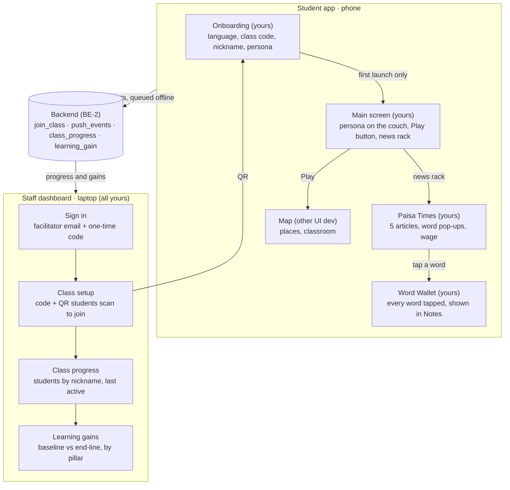

# UI Build Guide — Step by Step

Oct 10, 2026 · @Abhiraj Ratna

## 1. Orientation

You own four pieces: **onboarding**, the **main screen**, the **Paisa Times** newspaper and the **staff dashboard**. By **M2 (Sun 04:00)** a new player must get through onboarding onto the main screen (their character on a couch, a Play button, a news rack), tap Play to reach the map, and tap the news rack to read the paper, tap a word, answer a question and see the paper-route wage land. By **feature freeze (Sun 08:30)** the dashboard must show a class code and QR, a progress table and the learning-gains chart.

### What the game is, in UI terms

Paisa Path is a web app that looks and plays like a small pixel-art game on a phone. The player runs Sana's or Ravi's money week by week. The **engine** (BE-1's lane) decides what happens; the UI shows the state and passes taps to it. Your pieces frame that loop: onboarding is the way in, the main screen is where every session starts, Paisa Times is a side activity that pays a wage, and the dashboard is a separate website for teachers (called facilitators). The map, places and decisions behind the Play button belong to the other UI dev.

### Your four pieces

| Piece | Who uses it, where | What it does | Lives in |
| --- | --- | --- | --- |
| Onboarding | Student, once, on a phone | Language, class code, nickname and avatar, persona, 3 how-to-play cards, in under a minute | `apps/student/src/features/onboarding` |
| Main screen | Student, every session, on a phone | The player's character sits on a couch near the top; a big **Play** button opens the map; a **news rack** opens Paisa Times | `apps/student/src/features/main` |
| Paisa Times | Student, on a phone | A weekly paper of 5 short articles. Highlighted words open a thought-cloud meaning; one question per article pays the paper-route wage | `apps/student/src/features/news` |
| Staff dashboard | NGO facilitator, on a laptop | Sign in, create a class and get its code and QR, see each student's progress, compare baseline and end-line quiz scores | `apps/dashboard` |

### Who builds what now

| Person | Builds | Note |
| --- | --- | --- |
| You | Onboarding; main screen; Paisa Times (reader, thought cloud, questions and wage, Word Wallet); staff dashboard | — |
| Other UI dev | Map, places, decisions, phone and scams, Home (sleep, Month Recap), the School classroom quiz (built) | Also owns the Kenney UI kit (`design/kenney.css`) and `App.tsx` navigation so far |
| BE-1 | Engine (including `earn()`), content (editions, glossary, personas, quizzes) | — |
| BE-2 | Supabase, api-client (`join_class`, `push_events`, `class_progress`, `learning_gain`), deploy, merges | — |
| Nobody yet | MessageInspector, Scam or Safe?, Time Machine; Me and Notes screens | Raise it with the team tonight |

This split differs from CLAUDE.md, which gives onboarding and the Room hub to UI-1 and describes a Room with a door, newspaper, trophy and notebook. Phase 0 records the new lanes and the simpler main screen in CLAUDE.md, because Claude reads it to decide which files you may edit.

### What exists today (checked Sat 23:00)

| Thing | State |
| --- | --- |
| Map screen (`src/screens/LocationScreen.tsx`); tapping School opens the classroom | Works |
| School classroom quiz (`src/features/classroom`): 5 practice questions, en + hi, tests | Works (other UI dev) |
| Kenney pixel UI kit (`src/design/kenney.css`): `k-btn`, `k-btn is-primary`, `k-panel`, `k-banner`, `k-round` | Works; reuse it for your buttons and panels |
| `App.tsx`: switches between map and classroom with `history.pushState`, so Android back works; `?lang=hi` switches language | Works; no main screen, onboarding or news yet |
| Translations: each feature keeps `content/en.json` + `hi.json` and a small `t()` (see `features/classroom/content/index.ts`); react-i18next not installed | Pattern to copy |
| `pnpm check` (typecheck + tests) and Vitest | Works |
| `pnpm` on your laptop | Fixed; your `package.json` has a new `packageManager` line that is not committed yet |
| Onboarding (`src/features/onboarding`) | Works |
| Main screen (`src/features/main`): persona on a couch (placeholder pixel art), news rack with "New" badge, Play → map | Works; start screen after onboarding |
| Paisa Times (`src/features/news`): front page, articles, thought-cloud words with speaker, questions with full/half wage, toast and coins, Word Wallet, `markNewEdition()` | Works on a copy of BE-1's edition 2026-W41 (`content/pack/`) |
| Shared game store (`src/game/useGame.ts`, Zustand + IndexedDB): common money wallet, health, sanity, `earn(amount, sourceId)` | Works; swap its internals for the engine when `packages/engine` is on main |
| Sudden events and the phone (`src/features/events`): an injury → hospital bill (pay, borrow from family, or rest); a phone with an inbox and chat threads, 4 scams to spot (KYC link, lottery fee, "double your money", OTP) and 3 real offers (tutoring hour, shop shift, savings club pointing to the Bank); red flags, lesson, 1930 helpline; debt and Pay back | Works on a deterministic schedule (steps = place visits and purchases); `?event=<id>` and `triggerEvent(id)` for the demo panel |
| `apps/dashboard` | Nothing yet |
| `packages/shared`, engine (`earn()`), content, api-client | Not on `main` yet (an `origin/Backend` branch exists) |
| Life meters API (`src/features/life`, see `docs/life-meters-api.md`): one common money wallet, health, sanity; the store's necessity/want options, work, school | Frontend API, meters bar and store sheet built; work/school buttons, engine and backend not yet |

### Which document wins

- **CLAUDE.md** is the source of truth for this weekend. **docs/Paisa Path — Product & Component Design.md** describes the long-term product; use it for ideas, not scope.
- **Main screen:** the team replaced CLAUDE.md's Room hub (door, newspaper, trophy, notebook) with a character on a couch, a Play button and a news rack. Until Phase 0 updates CLAUDE.md, tell Claude this in your prompt.
- **Onboarding:** CLAUDE.md's list (language, class code, nickname and avatar, persona, 3 cards). No baseline quiz and no picture-PIN in onboarding. Where the baseline and end-line quizzes live is still open: the School classroom quiz is practice only, kept separate so it cannot inflate learning gains.
- **Dashboard:** the design doc lists 9 staff screens; CLAUDE.md asks for 4: Sign in → Class setup (code and QR) → Class progress table → Learning gains chart. Build only those.
- **Paisa Times:** the rules in CLAUDE.md §5.8 (original explainers, `[[termId]]` words, one question per article, wage paid once per edition, half wage on retry, framed as a paper-route shift).
- Everywhere: **no hard-coded words in components.** Every visible word goes through a translation key, in English and Hindi.

### The clock

| Deadline (IST) | Hard limit | Aim for | You must have |
| --- | --- | --- | --- |
| M2 | Sun 04:00 | 03:30 | Onboarding, main screen and Paisa Times (words, questions, wage) working in Hindi, merged |
| Feature freeze | Sun 08:30 | 08:30 | Word Wallet; the dashboard's 4 screens with demo data; a "new edition" hook for the demo panel |
| Final | Sun 11:00 | 10:30 | Nothing new; bugs, copy and polish only |

Merge checkpoints are 23:30, 01:30, 03:15 and 07:30. `main` must run after each one.

### At a glance: your pieces and what they touch



Every session starts on your main screen: Play leads into the other UI dev's map, the news rack into your Paisa Times. The class code and QR from your dashboard are what students type or scan in your onboarding. Article text and the glossary come from BE-1's content pack, and the wage is paid through the engine's `earn()`.

## 2. Concepts you need first

About ten ideas cover your three pieces. Read this section once (about 15 minutes), then come back whenever a word in Section 4 is unfamiliar. The Glossary at the end has short definitions.

### 2.1 How a React screen works

- **Component:** a function that returns what to draw, written in JSX (HTML-like code). `ArticleView` and `ThoughtCloud` are components.
- **Props:** the inputs you hand a component, for example `<ArticleView article={a} edition="2026-W41" />`.
- **State:** data that changes over time, such as which onboarding step is showing or which word's popup is open. When state changes, React redraws whatever uses it.
- **Store:** one shared box of state that any component can read (Zustand). The other UI dev's `useGame` store holds the game, including the wallet. Your pieces read it and call one action on it: `earn`. You keep your own small stores for the profile, the Word Wallet and the dashboard.
- **Hook:** a function whose name starts with `use` that gives a component access to state or side effects (`useState`, `useEffect`, `useGame`).

The one mental model to keep: **the screen is a drawing of the current state.** You never move things by hand. A tap calls a function, the function returns new state, the store saves it, and React redraws.

```tsx
// What happens when the player answers a Paisa Times question correctly
const onCorrect = () => {
  const next = engine.earn(game, article.reward.wage, `news:${edition}:${article.id}`);
  setGame(next);                         // the wallet in the top bar redraws by itself
  showWageToast(article.reward.wage);    // "Paper-route shift done: +₹50"
};
```

### 2.2 Why this is easier than "real" game dev

There is no game loop running 60 times a second and no physics. Paisa Path is **turn-based**: nothing changes until the player taps. Ordinary web UI (buttons, panels, CSS animation) is enough. The game feel comes from three things: the pixel art, short animations, and sound. Game designers call those small touches **juice**.

### 2.3 UI patterns you will build

| Pattern | What it is | Where you use it |
| --- | --- | --- |
| Hub | One home screen that every session starts from | Main screen: Play → map, news rack → Paisa Times |
| Hotspot | A tappable object inside a picture | The news rack |
| Idle animation | A small looping movement (blink, breathe) that makes a still scene feel alive | The character on the couch |
| Stepper | One question per screen, progress dots, a big Next button | Onboarding |
| Card picker | Large tappable cards; the chosen one is clearly highlighted | Persona choice, avatar grid |
| Carousel | Cards the player swipes or steps through | The 3 how-to-play cards |
| Front page | A list of headlines that each open a full article | Paisa Times edition |
| Inline tappable word | A word styled to show it can be tapped | `[[termId]]` words: dotted marigold underline |
| Popover | A small bubble anchored to what was tapped, kept on screen | ThoughtCloud |
| Feedback panel | Right or wrong, plus a short explanation, after an answer | Article question |
| Toast | A short message that appears and fades | "Paper-route shift done: +₹50" |
| Juice | Small motion and sound that make taps feel alive | Coins flying to the wallet |
| Empty state | What a screen says when there is nothing yet | Word Wallet, a new class with no students |
| Data table | Rows and sortable columns | Class progress |
| Chart | Numbers drawn as bars | Learning gains |

### 2.4 UX rules

**On the phone (onboarding and Paisa Times).** The player is 16–18, on a cheap Android phone that may be shared, often on patchy data, possibly more comfortable in Hindi, and possibly anxious about money. The rules come from CLAUDE.md §6.

1. **Design at 360 px wide first.** That is a typical budget Android width.
2. **Text at least 16 px; tap targets at least 48×48 px.** 48 px is roughly a fingertip.
3. **Icon plus short label** on every choice and option.
4. **One main action per screen,** large and near the bottom, where the thumb rests.
5. **Every tap answers at once:** a pressed look, a sound or a small motion.
6. **No timers, no "you failed" screens.** A wrong answer shows the explanation and a retry.
7. **Leave room for Hindi.** Hindi labels are often longer and taller than English. Never give a text box a fixed width or height.
8. **Short reading.** Articles are at most 600 characters, about Class 8 reading level. Never a wall of text.
9. **The wage is earned, never free money.** Always frame it as the character's paper-route shift.
10. **Honour reduced motion and data saver;** both switch animations off. Offline is normal: a small banner, never an error screen.

**On the laptop (the dashboard).** A facilitator uses it before and after a class session, sometimes on a projector.

1. **Design for a laptop (about 1280 px wide) and a projector,** but keep it usable at 360 px.
2. **Plain and professional:** the same colours and fonts as the game, without game art.
3. **Tables:** one row per student, nicknames only, numbers right-aligned, sortable columns.
4. **Charts:** label axes and units, and say clearly when the data is demo data.
5. **Privacy:** never ask for or show real names, phone numbers or anything beyond nickname and class (CLAUDE.md §7.5).
6. **Every action confirms itself:** "Class created", "Code copied".

### 2.5 Design tokens and the design system

A **design token** is a named value for one design decision, written as a CSS variable: `--space-2: 16px`, `--radius-card: 12px`. Components use the names, never raw values. Change a token and every screen follows.

The **design system** is the tokens, the shared building blocks (Button, Card, Sheet, Banner) and `DESIGN.md`. The other UI dev most likely owns it (Phase 0 confirms). You use it, and ask them for changes instead of restyling locally. The dashboard can import the same `tokens.css`, so both apps match.

Two habits make layouts look professional with no design training:

- **8 px grid:** every margin, padding and size is a multiple of 8 (use 4 only for tiny gaps).
- **A short type scale:** a handful of fixed text sizes (for example 14, 16, 20, 28) instead of a new size per screen.

### 2.6 Pixel art in a web app

The game's map is pixel art; your phone screens should feel like part of the same game.

- **Scale pixel images by whole numbers only** (2×, 3×) and give them `image-rendering: pixelated`, or they blur.
- **Reuse what is already in the repo.** The classroom draws a 360×640 backdrop and scales the whole stage as one (`features/classroom/ClassroomScreen.tsx`), and `design/kenney.css` gives pixel buttons and panels (`k-btn is-primary` suits Play). Copy both so your screens match the rest of the game.
- **Pixel font for short titles; Noto Sans for reading.** The Paisa Times masthead and onboarding titles can use the pixel font through `PixelText`. Article text, meanings and questions must be plain 16 px text, especially in Hindi. `PixelText` is invisible to screen readers, so the same words also go in an `aria-label`.
- **Placeholders first.** An emoji character on a grey couch is fine until the flow works. Art comes last.

### 2.7 Animation basics

The `motion` library animates React components. You describe the start and end, and it fills in the frames:

```tsx
<motion.div initial={{ y: 40, opacity: 0 }} animate={{ y: 0, opacity: 1 }} />
```

`AnimatePresence` lets something animate as it leaves (a popup closing). Keep most animations between 150 and 300 ms, and switch them off with reduced motion or data saver.

### 2.8 Four tools your screens need

- **Floating UI** (`@floating-ui/react`): places a popup next to the tapped word. Its `flip` and `shift` options move it above or below and sideways so it never leaves a 360 px screen; `useDismiss` closes it on an outside tap.
- **speechSynthesis** (built into browsers): reads text aloud. Pick a voice whose language is `hi-IN` or `en-IN`; if the phone has none, hide the speaker button (CLAUDE.md lists voice-over as a Should).
- **Recharts:** a React chart library for the dashboard. The learning-gains chart is a `BarChart` with two bars (baseline and end-line) for each of the 4 pillars.
- **QR codes** (for example the `qrcode.react` package): `<QRCodeSVG value="https://<app>/join?code=AB12CD" />` draws a code any phone camera can scan.

## 3. Setup (about 20 minutes)

Your laptop has Node 23 (fine; CLAUDE.md needs 20+) but `pnpm` fails before it starts, so fix that first. Then run the app, set Chrome to look like a budget phone, and point Claude Code at the right folder.

### Step 1 — Fix pnpm

`/usr/bin/pnpm` is a Corepack shim. It tried to download pnpm 12.11.2 and left a broken copy in its cache ("Cannot find module … pnpm.cjs"). The repo's lockfile is version 9.0, which pnpm 9 reads.

```bash
rm -rf ~/.cache/node/corepack     # throw away the half-downloaded copy
pnpm -v                           # retry; should print a version
```

If it still fails, pin pnpm 9 for the repo. This adds a `packageManager` line to the root `package.json`, so tell BE-2 (the integrator) in the team channel:

```bash
cd ~/Documents/Megathon2026/megathon26-magadon
corepack use pnpm@9
```

Or just tell Claude: *"`pnpm -v` fails with a Corepack MODULE\_NOT\_FOUND error. Fix it without touching anything outside this repo except the Corepack cache."*

**Status (23:00):** done. Your root `package.json` now has a `packageManager` line pinning pnpm 9.15.9. Commit it on its own and tell BE-2, so the whole team uses the same pnpm.

### Step 2 — Install and run

```bash
cd ~/Documents/Megathon2026/megathon26-magadon
pnpm install
pnpm dev:student
```

Open `http://localhost:5173`. You should see the pixel-art town. Leave this terminal running: Vite reloads the page every time a file is saved.

The dashboard does not exist yet. Phase 6 creates `apps/dashboard` and adds a `pnpm dev:dashboard` script; it then runs in a second terminal on its own port.

### Step 3 — Make Chrome look like a budget phone

1. Press **F12** to open DevTools, then **Ctrl+Shift+M** for the device toolbar.
2. In the device dropdown choose **Edit… → Add custom device**: name it "Budget Android", width **360**, height **760**, device pixel ratio **2**, type Mobile. Select it.
3. Use this device for all work. Check a wide screen only at the end.
4. For performance checks (not every time): Network tab → **Slow 4G**; Performance tab → gear icon → CPU **4× slowdown**.

For the dashboard, choose **Responsive** in the same dropdown and set **1280 × 800** (a laptop). Check it at 360 px too, once per screen.

### Step 4 — Open it on your real phone

```bash
pnpm dev:student --host
```

Vite prints a **Network** address such as `http://192.168.x.x:5173`. Open it on a phone on the same Wi-Fi. If it does not load, your laptop firewall is probably blocking port 5173. Offline install (PWA) only works on HTTPS, so test that on the deployed Vercel link later, not here.

### Step 5 — Point Claude Code at the repo

- Your VS Code window is open on the parent folder `Megathon2026`. Open **`megathon26-magadon`** itself (File → Open Folder) and start Claude there. Claude loads `CLAUDE.md` automatically from the folder it starts in; from the parent folder it can miss it.
- Check it worked: ask Claude *"Summarise CLAUDE.md section 6 in 5 bullets."* If it has to search for the file, you are in the wrong folder.
- For any task touching more than 3 files, switch to **plan mode** first (Shift+Tab in the Claude input). Claude writes a plan, you approve it, then it edits.

### Step 6 — Git habits for tonight

CLAUDE.md asks for task branches and no "Co-authored-by Claude" line in commits. Claude reads that rule from CLAUDE.md; remind it if a commit message shows the line.

```bash
git checkout main && git pull           # start every task from fresh main
git checkout -b ui/onboarding           # one branch per task: ui/onboarding, ui/news-reader, ui/dashboard ...
# ...work, commit small and often...
pnpm typecheck                          # until `pnpm check` exists, run this before each commit
git push -u origin ui/onboarding        # then open a pull request; BE-2 merges at checkpoints
```

Aim to have something merged at each checkpoint (23:30, 01:30, 03:15, 07:30). A small working piece on `main` beats a big branch nobody has seen.

### Step 7 — Know what you depend on

Your screens need things other people are building. Until each one lands, use a small **stand-in** with the same shape, kept in one file, so swapping in the real thing is a one-file change.

| You need | From | Stand-in until it lands |
| --- | --- | --- |
| The map behind the Play button | Other UI dev: `src/screens/LocationScreen.tsx`, opened from `App.tsx` | Already on `main` |
| Screen switching and Android back | Other UI dev: `App.tsx` (`history.pushState`) | Add your screens to it the same way; tell them what you changed |
| Translations | Each feature's `content/en.json` + `hi.json` and `t()` (classroom pattern) | Copy the pattern into each of your feature folders |
| `Article`, `GlossaryTerm`, `GameState` types | `packages/shared` (frozen contract) | A temporary copy in your feature folder, marked "replace when shared lands" |
| One Paisa Times edition (5 articles) and the glossary | BE-1: `packages/content/news/<edition>.json`, `glossary.json` | `src/features/news/sample-edition.ts` with 5 short placeholder articles |
| Sana's and Ravi's details and art | BE-1: `packages/content/personas.json`; art from you or the other UI dev | The personas table in the design doc; emoji until art exists |
| The wallet and `earn()` | The engine, through the other UI dev's game store | Ask them for an `earn(amount, sourceId)` function; until then a local function that logs the payment |
| `join_class` | BE-2: `packages/api-client` | `src/api/joinClass.ts` that accepts any code |
| Staff sign-in, `class_progress`, `learning_gain` | BE-2 | `apps/dashboard/src/api.ts` returning seed data |
| Baseline and end-line quiz scores | Not decided (the classroom quiz is practice only) | Seed data, labelled "Demo data" on screen |
| Health and sanity meters; store, work and school actions | BE-1: `buy`, `work`, `attendSchool`, `GameState.money` (one common wallet) and `GameState.vitals`; BE-2: three new event types (`docs/life-meters-api.md` §4–5) | `lifeApi` in `src/features/life/life.ts`, a local stand-in with the same rules |

### Setup is done when

- [ ] `pnpm -v` prints a version
- [ ] `pnpm dev:student` shows the town at `localhost:5173`
- [ ] Chrome's "Budget Android" 360 px view shows the town with no sideways scroll
- [ ] Your phone loads the town over Wi-Fi
- [ ] Claude, started inside `megathon26-magadon`, can summarise CLAUDE.md section 6 without searching

## 4. Step-by-step build plan

Build in **12 phases** (0–11). Phases 0–5 make your part of the M2 demo (onboarding, main screen, Paisa Times); Phase 6 adds the Word Wallet; Phases 7–10 build the dashboard before freeze; Phase 11 is polish. Every phase ends with something you can tap. If a phase runs 30 minutes past its time box, use the cut list at the end of this section rather than skipping a later phase.

| Phase | Time (IST) |
| --- | --- |
| 0 · Agree split, learn patterns | 23:00–23:20 |
| 1 · Onboarding | 23:20–00:15 |
| 2 · Main screen | 00:15–01:00 |
| 3 · Paisa Times reader | 01:00–01:40 |
| 4 · Thought-cloud words | 01:40–02:20 |
| 5 · Questions and wage | 02:20–03:00 |
| Hook-up with the other UI dev | 03:00–03:15 |
| **M2 gate** | 03:15–03:30 (M2 due 04:00) |
| 6 · Word Wallet | 03:30–04:00 |
| 7–10 · Dashboard, plus your sleep shift | 04:00–08:30 (freeze 08:30) |
| 11 · Polish and video | 08:30–10:30 (final due 11:00) |

The main screen took 45 minutes from the schedule, so the Word Wallet moved to just after M2, which does not need it. The dashboard shares its window with your sleep shift, so it is built against seed data and kept plain.

### How to run every phase

1. Read the phase's goal and its **Done when** list.
2. Make a branch: `git checkout -b ui/<phase-name>`.
3. Paste the phase's Claude prompt (adjust anything that has changed). Approve Claude's plan before it edits.
4. Look at the result: the 360 px "Budget Android" view for phone screens, 1280 px for the dashboard. Tap everything. Switch to Hindi.
5. Tell Claude what looks wrong, with a screenshot (Section 5 shows how).
6. Tick the **Done when** list, run `pnpm typecheck`, commit, push, open a pull request.

Placeholders are fine in every phase: an emoji avatar or a grey box for an article picture is fine until Phase 10. **Flow first, art last.**

### Phase 0 — Agree the split and learn the patterns (23:00–23:20)

**Goal:** 30 minutes of talking and small setup that saves hours of merge conflicts later. Your screens plug into the other UI dev's app, so agree where the plugs are before either of you writes them.

- [ ] **With the other UI dev, agree who owns the shared foundations:** design tokens (`src/design`), translation setup (`src/i18n`), stores (`src/game`, `src/app`) and the app shell with navigation. Recommended: they own all four (CLAUDE.md's UI-1 role), and you build only inside your feature folders.
- [ ] **Agree the hand-off points** in the table below, and post them in the team chat.
- [ ] **Update CLAUDE.md §3** with the new lanes and the main screen (Prompt 0a). Claude uses it to keep you in your own folders.
- [ ] **Message BE-1:** when do a sample edition, `glossary.json` and `personas.json` land?
- [ ] **Message BE-2:** api-client `join_class`; staff sign-in; `class_progress` and `learning_gain`; seed data for the dashboard.
- [ ] **Message the team:** MessageInspector, Scam or Safe? and Time Machine have no owner.
- [ ] **Do not build shared foundations yourself;** copy the repo's existing patterns instead (Prompt 0b): per-feature translations and the Kenney UI kit.

| Hand-off | Direction | What it looks like in code |
| --- | --- | --- |
| Onboarding finishes | You → you | `<Onboarding onDone={(profile) => …} />` opens your `<MainScreen />` |
| Play | You → other UI dev | `<MainScreen onPlay={…} />`: `App.tsx` opens their map; Android back returns to the main screen |
| News rack | You → you | `<MainScreen onOpenNews={…} />` opens your `<PaisaTimes />` |
| Paper-route wage | You → engine | You call `earn(amount, sourceId)` from the other UI dev's game store |
| Word Wallet | You → owner of Notes | They render your `<WordWallet />` (Notes has no owner yet) |
| Demo panel "mark a new edition" | Demo panel owner → you | Their panel calls your `markNewEdition()` |
| `App.tsx` | Shared | You add `onboarding`, `main` and `news` screens the way `classroom` is added, and tell the other UI dev each time |
| Quiz scores for the dashboard | Baseline/end-line owner → BE-2 → you | `quiz_submitted` events; your dashboard reads `learning_gain` |
| Meters bar, store sheet, work and school | Other UI dev | `MetersBar` and `StoreSheet` are built; work and school buttons call `lifeApi.work / attendSchool` (`docs/life-meters-api.md` §6) |

**Prompt 0a — record the new lanes**

```text
Update CLAUDE.md to match decisions the team made tonight. Change nothing else, and show me the diff before saving.
1. Section 3 (lanes): UI-1 (other UI dev) = map, places, decisions, phone and scams, Home (sleep, Month Recap), the School classroom quiz, the Kenney UI kit (apps/student/src/design/**). UI-2 (me) = onboarding (apps/student/src/features/onboarding/**), the main screen (apps/student/src/features/main/**), Paisa Times (apps/student/src/features/news/**), staff dashboard (apps/dashboard/**). App.tsx is shared: both may add screens. MessageInspector, Scam or Safe?, Time Machine, Me and Notes: owner to be decided.
2. Section 1.1 (hub): the app opens on a main screen. The player's character sits on a couch at the top, a Play button opens the map, and a news rack opens Paisa Times. This replaces the room with a door, newspaper, trophy and notebook.
3. Section 6: update the two UI build orders to match.
4. Section 12: add decision lines for the new lanes and the main screen, dated today, by "team".
```

**Prompt 0b — learn the patterns already in the repo**

```text
Read apps/student/src/App.tsx, src/features/classroom/ (ClassroomScreen.tsx, classroom.css, content/index.ts, quiz.test.ts) and src/design/kenney.css. Explain to me, as someone new to React, in at most 10 bullets: how screens are switched and how Android back works; how the 360x640 stage is scaled; how translations work with t(); which Kenney classes to use for buttons and panels; how tests are written. Then list what I should copy for my onboarding, main screen and Paisa Times. Don't change any files.
```

**Done when**

- [ ] You and the other UI dev have agreed the hand-offs in the team chat, including that `App.tsx` is shared
- [ ] CLAUDE.md shows the new lanes and the main screen (Prompt 0a)
- [ ] BE-1 and BE-2 have your requests
- [ ] You can explain the classroom's patterns (Prompt 0b), and `pnpm check` passes

### Phase 1 — Onboarding (23:20–00:15)

**Goal:** a new player gets from first launch to the main screen in under a minute: language, class code, nickname and avatar, persona, three how-to-play cards. CLAUDE.md wants the first decision within 3 minutes of opening the app, and onboarding is the first part of that.

**Prompt 1a — the five steps**

```text
Use plan mode. Copy the patterns in src/features/classroom: Kenney UI kit buttons and panels (k-btn, k-btn is-primary, k-panel), and a content/ folder with en.json + hi.json and a t() helper.
Build onboarding in apps/student/src/features/onboarding as 5 steps with progress dots and a large Next button at the bottom. Export one component: <Onboarding onDone={(profile) => void} />.
1. Language: two large buttons, "English" and "हिन्दी". Switches the language immediately and tracks language_changed.
2. Join class: a large uppercase class-code input and a Join button. If the page URL has ?code=XXXX, pre-fill it (the dashboard's QR will link here). Create src/api/joinClass.ts faking join_class from CLAUDE.md 5.5 (any non-empty code works; returns a fake anon_id and class_id) so BE-2's api-client can replace it later. A wrong code shows a friendly message, never a raw error.
3. Nickname and avatar: a text input (max 16 characters, letters and numbers) and a grid of 6 preset avatars (emoji placeholders for now). The hint says "a nickname, not your real name".
4. Persona: two cards, Sana and Ravi, each with a portrait placeholder, age, a one-line story, monthly income and goal, from the personas table in docs/Paisa Path — Product & Component Design.md (marked temporary until packages/content/personas.json exists).
5. How to play: 3 cards (Play opens the map, where pins show this week's tasks; choose and see what happens, and you can rewind; the news rack holds Paisa Times, which pays for your paper-route shift).
On finish: save the profile (nickname, avatar, persona, language, class) to IndexedDB (install idb-keyval), track onboarding_complete and persona_selected, then call onDone(profile). Export loadProfile() so the app can skip onboarding on reload.
Track events with the shared track() helper if it exists; otherwise a local stub that logs to the console, in one file, so it is easy to connect later.
Every word through t() keys in content/en.json and hi.json. Every tap target at least 48 px at 360 px wide. Run pnpm check.
```

**Prompt 1b — see it before the shell exists**

```text
Add an 'onboarding' screen to App.tsx the same way 'classroom' is added. Start there when no profile is saved (loadProfile()); otherwise start on the map for now (Phase 2 adds the main screen). Keep the change small and list exactly what you changed so I can tell the other UI dev.
```

Tell the other UI dev you touched `App.tsx`, since it is theirs.

**Done when**

- [ ] A fresh start (DevTools → Application → Storage → Clear site data, then reload) walks all 5 steps
- [ ] Reloading after finishing skips onboarding
- [ ] Choosing Hindi on step 1 shows every later step in Hindi, with nothing cut off
- [ ] Opening `/?code=AB12CD` pre-fills the class code
- [ ] A stopwatch run from the first screen to the end takes under 60 seconds
- [ ] Merged by the **01:30** checkpoint at the latest

### Phase 2 — Main screen (00:15–01:00)

**Goal:** the screen every session starts on. The player's character sits on a couch near the top; a big **Play** button opens the map; a **news rack** opens Paisa Times. CLAUDE.md calls this the Room hub (`RoomHub`); the team simplified it to these three things.

A layout to start from (a suggestion, not a spec):

```text
+--------------------------------+
| ₹4,200            Month 1 · W2 |  small top bar (optional)
|                                |
|      [ Sana on the couch ]     |  the scene: top ~60%
|                                |
|                   [ news rack ]|  tappable, "Paisa Times" label
|                   [   NEW     ]|  + badge when unread
|                                |
|     +--------------------+     |
|     |      >  PLAY       |     |  biggest thing on screen,
|     +--------------------+     |  in thumb reach
+--------------------------------+
```

**Rules for this screen**

- The character is the persona chosen in onboarding (Sana or Ravi), read from the saved profile.
- **Play is the one main action:** at least 56 px tall, near the bottom, a Kenney primary button with a play icon and a label.
- The news rack is a hotspot of at least 48 px with a visible "Paisa Times" label and a "New" badge while the current edition has unanswered articles.
- A small idle loop on the character (blink or breathe) makes the scene feel alive. Turn it off with reduced motion or data saver.
- Back from the map or the paper returns here.
- Open question for the team: where do **Me** (badges, XP) and **Notes** (lesson cards, Word Wallet) go now? Two small icon buttons on this screen is the simplest answer.

**Prompt 2a — the screen with placeholder art**

```text
Use plan mode. Read src/features/classroom/ClassroomScreen.tsx, classroom.css and src/design/kenney.css first, and copy their patterns (a 360x640 stage scaled as one, Kenney buttons and panels, a content/ folder with en.json + hi.json and t()).
Build MainScreen in apps/student/src/features/main: the screen every session starts on. The team replaced CLAUDE.md's Room hub with this. Export <MainScreen profile={profile} onPlay={() => void} onOpenNews={() => void} />.
- Scene (top ~60%): a room with the player's persona (Sana or Ravi, from the saved profile) sitting on a couch. Placeholder art for now: CSS wall and floor, a couch shape, an emoji for the character. A gentle 2-frame idle loop (blink or breathe); none with reduced motion or data saver.
- News rack: a tappable object in the room with a visible "Paisa Times" label and a "New" badge while the current edition has unanswered articles (hard-code true until Paisa Times exists). Tap area at least 48 px. Tapping calls onOpenNews.
- Play: one large Kenney primary button near the bottom (at least 56 px tall, play icon + "Play"). Tapping calls onPlay.
- Optional small top bar: wallet total in Indian rupee format and "Month 1 · Week 2" (fake values until the game store exists).
- Track app_open when the screen first shows (local stub if the shared track() does not exist).
- Every word through t() keys in en and hi. Test at 360 px. Run pnpm check.
```

**Prompt 2b — make it the start screen**

```text
In App.tsx add 'main' and 'news' screens the same way 'classroom' is added. After onboarding, and on every later launch, start on 'main'. MainScreen's onPlay opens 'map' and onOpenNews opens 'news' (a placeholder until Paisa Times exists), both with history.pushState so Android back returns to the main screen. Keep the change small and list exactly what you changed so I can tell the other UI dev.
```

**Prompt 2c — real art (only once the flow works)**

```text
Look at tools/build-classroom.py and how it builds public/assets/classroom.png. Propose how to build a matching 360x640 living-room backdrop with a couch, plus separate sprites for each persona sitting (2 idle frames) and a news rack, from assets already in the repo or CC0 packs you name with their licence. Show me the plan first; don't download anything yet.
```

**Done when**

- [ ] After onboarding, the app opens on the main screen with the chosen persona on the couch
- [ ] Play opens the map, and Android back returns to the main screen
- [ ] The news rack opens the news screen (or its placeholder) and shows "New"
- [ ] Play is the biggest thing on screen and sits in thumb reach at 360 px
- [ ] Hindi works, and nothing moves with reduced motion on
- [ ] Merged by the **01:30** checkpoint, together with onboarding

### Phase 3 — Paisa Times reader (01:00–01:40)

**Goal:** the newspaper opens from the main screen's news rack: a front page with 5 headlines, each opening a short article.

**Prompt 3a — a stand-in edition** (skip it if BE-1's edition has landed)

```text
Read CLAUDE.md sections 5.1 (Article, GlossaryTerm), 5.8 (Paisa Times rules) and 7.2 (guardrails). Create apps/student/src/features/news/sample-edition.ts: one edition "2026-W41" with 5 short articles (UPI fraud, inflation and prices, interest and family loans, loan-app rules, payment safety) and the glossary terms they use, in the exact Article and GlossaryTerm shapes, with t: keys and the en + hi strings in our i18n files. Original explainers only; body at most 600 characters; about Class 8 reading level; no real bank, app, fund or scheme names; no advice; 2–3 [[termId]] words per article; one question each with an explanation; a small wage (for example ₹50). Mark everything meta.status "draft" and add a comment that BE-1's edition in packages/content replaces this file.
```

**Prompt 3b — the reader screens**

```text
Use plan mode. Build the Paisa Times reader in apps/student/src/features/news. Export <PaisaTimes /> as the News screen.
- NewsFrontPage: a masthead ("Paisa Times" via PixelText, with an aria-label), the edition date, one line about the paper-route shift ("Answer each article's question to finish your paper-route shift"), and 5 headline cards. Each card shows the headline, a small icon, and a tick once its question is answered. A progress line: "2 of 5 done · ₹100 earned".
- ArticleView: a back button, the headline, body text in Noto Sans 16 px or more, an illustration placeholder, and a question block at the bottom (a stub for now). Render [[termId]] markers as plain bold words for now; Phase 3 makes them tappable.
- A newsprint look from tokens: off-white paper, dark ink, thin rules between sections. Readable, not fancy.
- Read the edition through one function, getEdition(), so BE-1's real content replaces sample-edition.ts in one place.
- The back button inside an article returns to the front page; handle the Android back button the same way the app shell does (ask me if there is no shell yet).
Every word through i18n. Run pnpm typecheck and tell me how to open it in the browser.
```

**Done when**

- [ ] The front page shows 5 headlines and the edition date
- [ ] Each headline opens its article, and back returns to the front page
- [ ] Hindi works, with nothing cut off at 360 px
- [ ] Only `getEdition()` knows where the articles come from

### Phase 4 — Thought-cloud words (01:40–02:20)

**Goal:** tapping a highlighted word opens a thought-cloud bubble with a simple meaning, an everyday example and a speaker button, and saves the word to the Word Wallet.

**Prompt 4**

```text
Use plan mode. In apps/student/src/features/news:
- GlossaryWord: renders a [[termId]] word inside article text with a dotted marigold underline (token colour). It is a real button for accessibility, with a tap area of at least 48 px that does not change the line height.
- ThoughtCloud: tapping a GlossaryWord opens a popup anchored to it with @floating-ui/react (offset, flip, and shift with 8 px padding, so it never leaves a 360 px screen). It looks like a thought cloud: a rounded bubble with two small circles trailing toward the word. Inside: the word, its simple meaning (Noto Sans 16 px), an everyday example, a speaker button, and a small "Saved to your Word Wallet" note.
- Speaker button: speechSynthesis with a hi-IN or en-IN voice matching the current language; hide the button when no such voice exists.
- Close on an outside tap, on Escape and on Android back. Only one popup open at a time.
- Opening a word tracks glossary_term_opened { term_id, article_id } and adds the term to a Word Wallet store (Zustand + idb-keyval) in src/features/news/useWordWallet.ts.
- A 150 ms pop-in; none with data saver or reduced motion.
Every word through i18n. Run pnpm typecheck.
```

**Done when**

- [ ] Every `[[termId]]` word is underlined and opens its cloud
- [ ] A word at the very left or right edge still shows the whole cloud on screen
- [ ] The speaker reads the meaning in the current language, or is hidden
- [ ] The word is still in the Word Wallet after a reload

### Phase 5 — Questions and the paper-route wage (02:20–03:00)

**Goal:** each article ends with one question. A right answer pays the paper-route wage into the game wallet; a wrong answer explains and allows one retry for half the wage.

**Prompt 5**

```text
Use plan mode. Build the article question in apps/student/src/features/news, following CLAUDE.md 5.8 exactly.
- QuestionCard at the bottom of ArticleView: the prompt, and the options as large buttons (a letter or icon + label, at least 56 px tall).
- Right answer: the option gets a tick, the explanation shows, and the wage is paid with useGame.earn(article.reward.wage, `news:${edition}:${article.id}`). If useGame.earn does not exist yet, call a placeholder in src/features/news/pay.ts that logs, and remind me to ask the other UI dev for it.
- Wrong answer: the option is clearly marked (calm, not alarming), the explanation shows, and one retry is allowed. A right retry pays half the wage, rounded down to whole rupees. After the retry, show the correct answer.
- Each article pays at most once per edition, even after a reload: store answers in IndexedDB (earn() is also idempotent per sourceId).
- After paying: a toast "Paper-route shift done: +₹50" and coins flying toward the wallet in the top bar (no animation with data saver). Never call it free money or a prize; it is earned income.
- Track news_question_answered { edition, article_id, correct, attempt }. When all 5 are answered, track news_edition_completed { edition, correct_count } and show an "Edition finished" card on the front page.
Every word through i18n; all money through formatRupees. Run pnpm typecheck.
```

**Done when**

- [ ] A right answer pays the full wage once; answering again pays nothing
- [ ] A wrong answer shows the explanation, and a right retry pays half
- [ ] A reload keeps the answers and never pays twice
- [ ] Finishing all 5 shows "Edition finished"

### Hook-up with the other UI dev (03:00–03:15)

**Goal:** your pieces work inside the real app, not only on their own. Do this together, on one laptop and one branch, to avoid merge pain.

- [ ] Onboarding hands over to your main screen, and the main screen is the start screen
- [ ] Play opens the other UI dev's map; Android back returns to the main screen
- [ ] The news rack opens `<PaisaTimes />`
- [ ] The wage lands in the real wallet through the game store's `earn`
- [ ] Your events go into the shared event queue

```text
Pull main. Check App.tsx end to end: onboarding → main screen → Play → map, and news rack → PaisaTimes, with Android back working everywhere. Connect my wage payment to the game store's earn() and replace my local track() stub with the shared one, if they exist. List every file you change outside my folders and why.
```

### M2 gate (03:15–03:30)

- [ ] On a real phone, in Hindi: fresh start → onboarding → main screen → news rack → article → tap a word → thought cloud → answer → wage lands; back → Play → map → back to the main screen
- [ ] No English left on Hindi screens; nothing cut off
- [ ] `pnpm check` passes; your branch is merged at the **03:15** checkpoint
- [ ] A 60-second screen recording for the progress PDF
- [ ] Tell BE-2 which parts still use stand-ins (content, `join_class`, `earn`)

### Phase 6 — Word Wallet (03:30–04:00, after M2)

**Goal:** a list of every word the player has tapped, for the Notes screen (owner to be decided).

**Prompt 6**

```text
Use plan mode. Build <WordWallet /> in apps/student/src/features/news from useWordWallet: the collected words (word + simple meaning), newest first, each reopening its ThoughtCloud. Show a count ("12 words"). Empty state: "Tap highlighted words in Paisa Times to collect them here." Export it so whichever screen shows Notes can render it. Also export markNewEdition() for the demo panel: it switches getEdition() to a fresh edition (or clears the current edition's answers if there is only one). Every word through i18n.
```

**Done when**

- [ ] Words tapped in articles appear, newest first
- [ ] An empty wallet shows the empty-state line
- [ ] `markNewEdition()` makes the front page fresh again

### Phases 7–10 — Staff dashboard (04:00–08:30, shared with your sleep shift)

**Goal:** four plain screens for a facilitator on a laptop: Sign in → Class setup (code and QR) → Class progress → Learning gains. After a 3-hour sleep you have about 2 hours of building, so everything runs on seed data first and swaps to BE-2's real functions in one file. Agree your sleep slot with the team before M2.

#### Phase 7 — Dashboard app and sign-in

```text
Read CLAUDE.md sections 4, 5.5, 5.6 and 7.5. Use plan mode. Create apps/dashboard: Vite + React + TypeScript, using the same tokens.css as the student app (import or copy it; tell me which). Add root scripts "dev:dashboard" (pnpm --filter dashboard dev) and a typecheck script for it.
- src/api.ts: the only file that talks to the backend. For now it fakes signIn(email), verifyCode(email, code), createClass(name, lang), listClasses(), classProgress(classId) and learningGain(classId) with realistic seed data (about 12 students with nicknames, 4 pillars), so BE-2's api-client replaces it in one place. Mark seed data so screens can show a "Demo data" badge.
- Layout: a top bar with the app name and the signed-in email; a left menu (Classes, Progress, Learning gains) that becomes a top menu under 768 px.
- Sign in: email → "Send code" → 6-digit code → Sign in. Clear, friendly errors.
- Every word through i18n (en + hi), like the student app. Run pnpm typecheck and tell me how to open it.
```

- [ ] `pnpm dev:dashboard` opens the dashboard
- [ ] Any email and code reach an empty Classes screen
- [ ] It looks right at 1280 px and is usable at 360 px

#### Phase 8 — Class setup with code and QR

```text
Use plan mode. In apps/dashboard build Class setup: a form (class name; default language English or Hindi) → Create → a class card with the class code in large letters and a Copy button, a QR code (qrcode.react) that opens the student app at /?code=<code>, and a "Print join sheet" button that prints one clean A4 page (class name, code, QR, 3 steps for students). The student app URL comes from VITE_STUDENT_URL with a localhost default, added to .env.example. Existing classes are listed below the form.
```

- [ ] Creating a class shows its code and QR
- [ ] Scanning the QR with your phone opens the student app with the code pre-filled (your Phase 1 `?code=` feature)
- [ ] Print preview is one clean page

For the QR to work from a phone, `VITE_STUDENT_URL` must be the deployed student app or your laptop's Network address.

#### Phase 9 — Class progress table

```text
Use plan mode. In apps/dashboard build Class progress for the selected class from classProgress(classId): one row per student with the fields class_progress returns in CLAUDE.md 5.5 (nickname, modules done, last active), sortable columns, numbers right-aligned, a search box, and an "Inactive 7+ days" flag shown as icon + label. Nicknames only. A "Demo data" badge on seed data. For a class with no students, show the code and QR again with "Share this code to get students started."
```

- [ ] Seed students show, sortable and searchable
- [ ] Inactive students are flagged with icon and label, not colour alone
- [ ] Readable on a projector (try browser zoom at 125%)

#### Phase 10 — Learning-gains chart

```text
Use plan mode. In apps/dashboard build Learning gains from learningGain(classId): a Recharts grouped bar chart with the 4 pillars (Plan & budget, Save & manage, Understand investing, Stay financially safe) on the x-axis and two bars each, baseline and end-line average score (0–100%), with a legend, value labels, and a one-line summary above it computed from the data (for example "Average score rose from X% to Y%"). A "Demo data" badge on seed data and a friendly empty state when nobody has taken the end-line quiz yet. Colours from tokens, never colour alone.
```

- [ ] 4 pillars × 2 bars, labelled
- [ ] The summary sentence matches the bars
- [ ] "Demo data" shows on seed data

Ask the other UI dev and BE-2 how quiz answers reach `learning_gain` (`quiz_submitted` events → the `quiz_attempts` table), so the chart can switch from seed data to real data.

### Phase 11 — Polish and deliverables (08:30–10:30)

After 08:30 there are **no new features**: bugs, copy and polish only.

- [ ] Run the Section 6 polish checklist on your three pieces
- [ ] Help record the demo video: steps 2 (onboarding), 3 (main screen → map), 7 (Paisa Times) and 9 (dashboard) of the CLAUDE.md §9 script are yours
- [ ] Agree with the team who finishes the slides (by 10:00) and the final report (by 10:30)

### Cut list (when you are behind)

Cut from the top, one item at a time, and tell the team what you cut.

1. Real art → an emoji character on a grey couch, grey article pictures
2. Idle and coin animations → a still scene and the toast alone
3. Speaker button → hidden
4. Print join sheet → code and QR on screen only
5. Progress search and sorting → a plain table
6. Dashboard sign-in → one "Enter as demo facilitator" button (tell BE-2)

**Never cut:** Hindi, the main screen's Play and news rack, the question → wage flow, thought-cloud words, the class code and QR, the learning-gains chart, "Demo data" labels.

## 5. Working with Claude

Claude writes most of the code. Your job is three things: give it one clear, small task at a time; check the result on the screen; and stop it from breaking other people's work.

### 5.1 The loop for every task

1. **One task per conversation.** Type `/clear` before each new phase so Claude is not distracted by old context. CLAUDE.md reloads automatically.
2. **Plan mode for anything over 3 files** (Shift+Tab). CLAUDE.md requires a short plan for these.
3. **Read the plan before approving.** Check two things: it only touches your folders (`src/features/onboarding`, `src/features/main`, `src/features/news`, `src/api`, `apps/dashboard`, plus small additions to the shared `App.tsx`), and it puts words through translation keys. Anything else (the map, the classroom, `design/kenney.css`, `packages/*`, `supabase`) needs a heads-up to its owner first.
4. **Let it run,** and use the wait: write the next prompt, or test the last phase on your phone.
5. **Look at it in the browser.** Claude cannot see your screen unless you show it.
6. **Give feedback with a screenshot** (5.3).
7. **Commit** as soon as one "Done when" item works.

### 5.2 A good prompt has five parts

| Part | Example |
| --- | --- |
| Where | "in `src/features/news`" |
| What it shows | "the headline, the body text, a question with 3–4 options" |
| What each tap does | "tapping a right option pays the wage with `useGame.earn` and shows a toast" |
| Rules | "every word through i18n; tokens only; tap targets at least 48 px" |
| How you will check | "run `pnpm typecheck` and tell me how to see it in the browser" |

A template to copy for any screen not covered in Section 4:

```text
Use plan mode.
Build <ComponentName> in <folder>.
It shows: <what is on screen, top to bottom>.
When the player taps <thing>, it <what happens>. It tracks <event> (CLAUDE.md 5.5).
Rules: every word through i18n (en + hi); colours, spacing and sizes from tokens.css only; tap targets at least 48 px; works at 360 px wide; no animation in data saver.
Do not touch files outside apps/student.
Finish by running pnpm typecheck and telling me exactly how to see it in the browser.
```

### 5.3 Show Claude what you see

- **Screenshot:** in the Chrome device toolbar, open the ⋮ menu → **Capture screenshot**. Paste or drag the image into the Claude input.
- **Say what is wrong and what you expected:** "At 360 px in Hindi, the second choice wraps to 3 lines and pushes Continue off the screen. Expected: at most 2 lines, Continue visible."
- **Paste errors whole:** copy the red text from the browser console (F12 → Console) or the terminal running Vite, all of it.

### 5.4 Prompts for common moments

| Situation | Paste this |
| --- | --- |
| You have never designed this kind of screen | "I've never designed a UI. Suggest 3 layouts for `<screen>` on a 360 px phone (or a 1280 px laptop for the dashboard) as ASCII sketches, with pros and cons. Don't write code yet." |
| It works but looks bad | "\[screenshot\] This screen looks cramped and unbalanced at 360 px. Improve spacing and hierarchy using only tokens.css values. Don't change behaviour." |
| It should feel more like a game | "Add juice to `<component>`: a pressed bounce on tap, coins flying to the wallet when the wage is paid, a soft sound. Under 300 ms; off in data saver." |
| The thought cloud goes off screen | "\[screenshot\] The ThoughtCloud for a word near the right edge is cut off at 360 px. Fix the Floating UI middleware (offset, flip, shift with padding) so it always stays fully visible." |
| The chart or table looks wrong | "\[screenshot\] The learning-gains chart `<what is wrong>`. Expected: 4 pillars, 2 labelled bars each, a legend, the Demo data badge." |
| Blank screen or crash | "The app shows a blank screen after I tap `<x>`. Console error: `<paste>`. Find the cause, explain it in two sentences, then fix it." |
| Hindi breaks the layout | "Switch to Hindi and check every screen in `src/features/<x>` at 360 px for text that overflows or is cut. Fix by wrapping, never by going below 16 px." |
| You want to understand the code | "Explain `src/features/news/ArticleView.tsx` like I'm new to React: what it shows, where its data comes from, and what happens when I tap an option." |
| Before every commit | "Review my uncommitted changes against CLAUDE.md sections 6 and 7: hard-coded words, colours outside tokens, tap targets under 48 px, missing Hindi keys, real names of banks or apps, files outside my lane." |
| Merge conflict after pulling main | "I have a merge conflict in `<file>`. Show me both sides, explain what each person changed, and resolve it keeping both changes." |
| Ready to commit | "Commit these changes with a clear message, push the branch and open a pull request." |

### 5.5 What to watch for

Reject or question the change when Claude:

- **Edits outside your lane:** the other UI dev's Room, Map, design system, stores or shell, or `packages/*` and `supabase`. Contracts are frozen; if Claude says a shared type must change, stop and ask the team.
- **Writes words straight into JSX** (`<button>Next</button>`) instead of `t('...')`.
- **Uses raw colours or sizes** (`#1aa`, `13px`) instead of token names.
- **Silences errors** with `any`, `// @ts-ignore`, or by deleting or skipping tests. CLAUDE.md forbids this.
- **Copies real news or names real banks, apps, funds or schemes** in sample articles, or gives advice ("you should invest"). Paisa Times articles are original explainers only (CLAUDE.md 5.8, 7.2).
- **Shows or asks for real names** anywhere, including the dashboard. Nicknames and class codes only.
- **Adds a live AI call** to the student app. CLAUDE.md 7.1 rules this out.
- **Installs several new libraries.** The student app has a budget of about 250 KB of JavaScript; ask why each one is needed.
- **Produces a much bigger change than expected.** Ask it to list every changed file and why.

### 5.6 Save points and getting unstuck

- **Commit every working step.** Then a bad change is cheap: `git diff` shows it, `git restore <file>` undoes it.
- Claude Code can also undo its own edits: press **Esc twice** (or type `/rewind`) to return to an earlier point in the conversation.
- **If Claude fails the same fix 3 times,** stop. Type `/clear`, then describe the bug fresh: what you did, what you expected, what happened, the full error, and what was already tried.
- **If a phase is past its time box by 30 minutes,** use the cut list (Section 4) or ask a teammate. Do not stay stuck alone.

## 6. Testing and polish

Test every phase as you go (2 minutes): phone screens at 360 px in both languages, the dashboard at 1280 px. Run the full checks at the M2 gate and again at freeze. The most useful single test is handing the phone to someone new and watching in silence.

### 6.1 Quick check after every phase

- [ ] Phone screens at 360 px, dashboard at 1280 px: nothing scrolls sideways
- [ ] Switch to Hindi and look at every screen from this phase
- [ ] Tap everything; every tap visibly responds
- [ ] The phone back button goes up one level (article → front page, popup → closed)
- [ ] Reload in the middle; the profile, answers and Word Wallet survive
- [ ] The browser console (F12 → Console) shows no red errors

### 6.2 Full checks (M2 gate and freeze)

| Check | How | Passes when |
| --- | --- | --- |
| Start flow | Clear site data, reload; finish onboarding; reload again | First launch shows onboarding, every later launch opens the main screen |
| Main screen loop | Play → map → Android back; news rack → paper → Android back | Both return to the main screen; the app never closes by surprise |
| Real phone | `pnpm dev:student --host`, or the deployed link | Everything works one-handed; Play is in thumb reach |
| Slow phone | DevTools: Network Slow 4G, CPU 4× slowdown | No tap feels laggy; the main screen appears without a long blank |
| Hindi | Walk every screen in Hindi | No English left, no text cut off, articles still short |
| Offline | DevTools Network → Offline | The main screen and Paisa Times still open (editions are bundled); answers still pay |
| Popup edges | Tap glossary words at the far left, far right and bottom of the screen | The whole thought cloud is always visible |
| Wage once | Answer, reload, answer again; try a wrong answer then a right retry | Full wage once; half wage on a right retry; never twice |
| QR join | Scan the dashboard's QR with your phone | The student app opens with the class code filled in |
| Projector | Dashboard at 125% browser zoom, from 3 m away | Table and chart readable; "Demo data" visible |
| Reduced motion | DevTools → Rendering → emulate `prefers-reduced-motion: reduce`; also data saver | The character and coins stay still |
| Accessibility | DevTools → Lighthouse → Accessibility, on each of your screens | No contrast or tap-target warnings |
| New player | Section 6.3 | Onboarding in under 60 seconds; Play found without help |

### 6.3 Run the new-player test properly

1. Find someone who has never seen the app. Say only: "It's a money game. Play it, and read the newspaper."
2. Stay silent. Do not point or explain. Time onboarding, then watch whether they find Play and the news rack on the main screen without help.
3. Write down every moment they hesitate or tap the wrong thing. Each one is a design bug, not a user mistake.
4. Fix the top 3, then test with someone else.
5. For the dashboard, ask a teammate to "create a class and show me how a student joins" without help.

### 6.4 Polish checklist

Polish is the small things that make a hackathon build look finished.

- [ ] Every button, hotspot and glossary word has a pressed state
- [ ] Spacing follows the 8 px grid, and items line up on the same left edge
- [ ] Each screen has one clear main button; on the main screen it is Play
- [ ] The main screen feels alive: the character's idle loop, a "New" badge on the news rack (both still with reduced motion)
- [ ] Your screens use the same Kenney buttons and panels as the classroom
- [ ] No blank screens: empty states say what will appear (Word Wallet, a class with no students)
- [ ] Money always shows as ₹ with Indian grouping (₹1,00,000)
- [ ] The newspaper looks like a newspaper: masthead, date, thin rules, readable body text
- [ ] The wage moment feels earned: toast plus coins (off in data saver)
- [ ] The dashboard looks calm and professional, with "Demo data" on every seeded number
- [ ] The demo path for your steps runs 3 times in a row from `?demo=1` without a reload

### 6.5 Before the final push (your part of CLAUDE.md §11)

- [ ] `pnpm check` passes (or `pnpm typecheck` if `check` still does not exist)
- [ ] No dev-only buttons visible unless the hidden panel is opened
- [ ] The deployed link works on a real phone
- [ ] The Hindi walk-through is done
- [ ] The demo video was recorded from the freeze build

## 7. Master checklist and glossary

Tick this list as you go; each line points to its full "Done when" list in Section 4.

### Master checklist

**Before M2 (submit by 03:30)**

- [ ] Setup: pnpm fixed and its `packageManager` line committed; app runs; "Budget Android" view; Claude started in the repo folder
- [ ] Phase 0 — Split agreed, CLAUDE.md updated (lanes + main screen), requests sent, repo patterns learned
- [ ] Phase 1 — Onboarding
- [ ] Phase 2 — Main screen (merged with onboarding by 01:30)
- [ ] Phase 3 — Paisa Times reader
- [ ] Phase 4 — Thought-cloud words
- [ ] Phase 5 — Questions and the paper-route wage
- [ ] Hook-up with the other UI dev (merged at 03:15)
- [ ] M2 gate: Hindi run on a real phone, 60-second recording, stand-ins reported to BE-2

**Before freeze (08:30)**

- [ ] Phase 6 — Word Wallet and `markNewEdition()`
- [ ] Stand-ins swapped for BE-1's edition and BE-2's `join_class` as they land
- [ ] Phase 7 — Dashboard app and sign-in
- [ ] Phase 8 — Class setup with code and QR (QR opens onboarding with the code)
- [ ] Phase 9 — Class progress table
- [ ] Phase 10 — Learning-gains chart (merged at 07:30)
- [ ] Main screen real art (Prompt 2c), only if everything above is done

**Before final (10:30)**

- [ ] Polish checklist (6.4) and final-push checklist (6.5)
- [ ] Your three demo-video steps recorded
- [ ] Slides and report owners agreed

**Messages to send tonight**

- [ ] Other UI dev: the hand-off table; `App.tsx` is shared; an `earn()` you can call; that the main screen is now yours
- [ ] BE-1: dates for a sample edition, `glossary.json` and `personas.json`
- [ ] BE-2: api-client `join_class`, staff sign-in, `class_progress`, `learning_gain`, dashboard seed data, the deployed student URL for the QR; the pnpm pin
- [ ] BE-1 and BE-2: the life meters proposal (`docs/life-meters-api.md` §4 engine functions, the common `money` wallet and `vitals`; §5 the `shop_purchase`, `work_shift` and `school_attended` events)
- [ ] Team: owners for MessageInspector, Scam or Safe?, Time Machine, Me and Notes; where the baseline and end-line quizzes live; your sleep slot

### Glossary

| Term | Meaning |
| --- | --- |
| Component | A reusable piece of screen, written as a function that returns JSX |
| Design system | Tokens + shared components + `DESIGN.md`; the rules that make every screen match |
| Design token | A named design value stored as a CSS variable, such as `--space-2: 16px` |
| Edition | One week's Paisa Times: 5 articles with an id like `2026-W41` |
| Engine | BE-1's pure TypeScript code that runs the game rules, including `earn()` |
| Facilitator | The NGO teacher who runs sessions and uses the dashboard |
| Feature freeze | 08:30 Sunday: after this, only bug fixes, copy and polish |
| Glossary term | A money word with a simple meaning and an everyday example, shown in the thought cloud |
| Health, sanity | The character's two 0–100 meters beside money. Store purchases raise sanity (wants more than necessities); work and school lower it |
| Hook | A function starting with `use` that gives a component state or side effects |
| i18n | Internationalisation: every visible word is a key, translated per language |
| IndexedDB | Storage inside the browser that survives reloads and works offline |
| JSX | HTML-like code inside TypeScript that describes what a component draws |
| Juice | Small animations and sounds that make taps feel alive |
| Lighthouse | Chrome's built-in checker for accessibility and performance |
| Monorepo | One repository holding several apps and packages; pnpm workspaces link them |
| Paper-route wage | The in-game money a right answer pays; framed as the character's earned shift, never free money |
| Placeholder | Temporary art or content used until the real thing exists |
| Plan mode | A Claude Code mode where Claude writes a plan for approval before editing |
| Popover | A small bubble anchored to what was tapped; the thought cloud is one |
| Props | The inputs passed to a component |
| Pull request | A request to merge your branch into `main`, where teammates can see the change |
| PWA | Progressive web app: a website that installs like an app and works offline |
| QR code | A square barcode a phone camera opens as a link; here it carries the class code |
| Recharts | The React chart library the dashboard uses |
| Reduced motion | A phone setting asking apps to avoid animation; the app must honour it |
| RLS | Row-level security in Supabase: each facilitator sees only their own classes |
| Seed data | Made-up demo data loaded so screens have something to show; always labelled |
| Stand-in | A temporary fake of another lane's code (content, api-client) with the same shape |
| State | Data that changes over time; React redraws whatever uses it |
| Store | Shared state any component can read; here Zustand stores such as `useGame` |
| Supabase | The hosted Postgres database and sign-in service BE-2 runs |
| SyncEvent | A small record of what the player did, queued offline and uploaded later |
| Tap target | The touchable area of a control; at least 48×48 px here |
| TypeScript | JavaScript with types; `pnpm typecheck` finds mistakes before running |
| Vite | The tool that runs an app locally, reloads on save, and builds it for release |
| WCAG AA | The common accessibility standard; here mainly text contrast |
| Word Wallet | The player's collection of every glossary word they have tapped |
